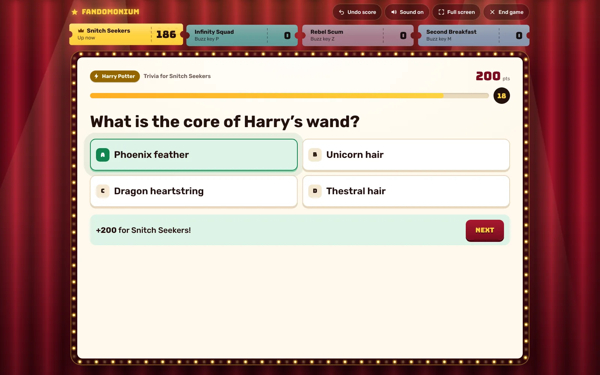
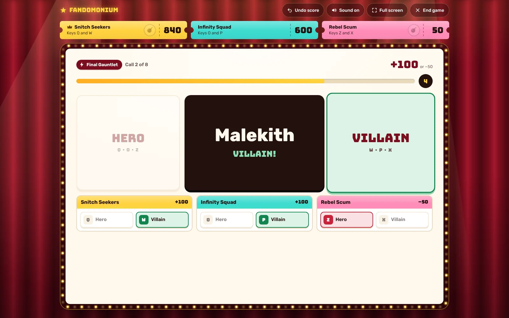

# Fandomonium

Movie, TV and anime trivia for 2 to 4 teams around one screen, with phones as controllers and a host with opinions. 1,058 questions across 21 fandoms, each rated Easy, Medium or Hard:

- **Movies:** Harry Potter, Marvel, DC, Star Wars, Lord of the Rings, Disney & Pixar, Hunger Games, Jurassic Park, Back to the Future, Studio Ghibli, Pirates of the Caribbean
- **TV:** Friends, The Office, Stranger Things, Game of Thrones
- **Anime and games:** Pokémon, One Piece, Naruto, Attack on Titan, Mario, Zelda

**[Play in your browser](https://matthewsleclair-hue.github.io/fandomonium/play/)** · **[Download for Windows](https://github.com/matthewsleclair-hue/fandomonium/releases/latest/download/Fandomonium.exe)** · **[Website](https://matthewsleclair-hue.github.io/fandomonium/)**



## Play with phones

Turn on **Play with phones** under House rules, the last setup screen. The TV shows a QR code and a four-letter room code, and everyone joins from their phone's browser (no app, Wi-Fi or mobile data both work).

- Pick your team in the lobby. Several people can share a team.
- On your team's turn, pick the fandom and answer on your phone.
- In All play, your phone becomes a big buzzer. Buzz first, then pick the answer, or type it for scrambles.
- The first phone to join is the VIP, who starts the game and moves things along from the couch.


Phones talk to the TV through EMQX's free public MQTT relay (`broker.emqx.io`) over secure WebSockets, so the TV and phones need internet. If the relay can't be reached, the lobby says so and the keyboard and on-screen buzzers still work. To use a different relay, change `NET.brokers` in `src/net.js`.

## Setting up

The title screen has **Let's play** and **How to play**. Setup takes four quick screens, and you can jump between them with the step buttons at the top:

1. **Teams**: 2 to 4 teams, each with a name, a colour and a buzz key
2. **Fandoms**: pick any of the 14
3. **Difficulty**: Easy, Medium, Hard or Mixed, and Quick (3 rounds), Standard (5) or Marathon (8)
4. **House rules**: phones, steals, Screw your neighbour and the snarky host, each on or off

Space or Enter goes to the next screen and Esc goes back. Your choices are remembered for next time.

## Difficulty

Every question is tagged 1 (easy), 2 (medium) or 3 (hard). Pick **Easy**, **Medium** or **Hard**, or **Mixed**, which starts easy and gets harder each round. When a level runs out of fresh questions, the game borrows from the nearest level before repeating anything.

Pick **Per team** to give each team its own level, so kids can play on Easy against adults on Hard. Each team's own questions use its level, and the shared All play puzzles use the average.

## How a game runs

Each round, every team gets its own question on the clock:

- **Trivia**: four answers, one right (200 points, 20 seconds)
- **Odd one out**: spot the one that doesn't belong (200 points)
- **Put it in order**: release dates, story order and more (300 points, 35 seconds)

Then comes **All play**. A puzzle reveals itself bit by bit while its value drops from 500 to 100, and the first team to buzz gets a shot:

- **Scramble**: letters slide into place one at a time
- **Who am I?**: four clues, hardest first
- **Emoji movie**: a film spelled out in emoji

A wrong pick locks that team out of the puzzle. The last round is worth double.

**Lifelines** (on by default): once per game, each team can use a **50/50** (two wrong answers disappear) and **+10 seconds** on its own question. Press 5 or 0, tap the buttons under the timer, or use your phone.

**Special rounds** (on by default) replace the usual questions for a whole round, so every team plays the same thing:

- **Rapid Fire**: 30 seconds of two-answer questions from your fandom. +50 for each right answer, −50 for each wrong one, and a turn never goes below zero.
- **Higher or Lower**: five movies, games or seasons in a row. Say whether each came out earlier or later than the one before (Left and Right arrows, 1 and 2, or your phone). +50 a call, +100 for a perfect streak, and a wrong call ends the turn. Years come from `HILO` in `src/show.js`.

A 3-round game goes classic, Rapid Fire, Higher or Lower. A 5-round game puts Rapid Fire in round 2 and Higher or Lower in round 4, and an 8-round game has two of each.

**Steals** (on by default): when a team misses its own question or runs out of time, the other teams get 8 seconds to buzz in. The first to buzz picks from the remaining answers and steals it for half the points.

**Screw your neighbour** (on by default): once per game, each team can mess with a rival during that rival's own question. Tap the bomb on your ticket, or the button on your phone, then scramble their question (every word's middle letters get shuffled) or slash their timer to 6 seconds.

The show ends with the **Final Gauntlet**, a Dis-or-Dat round at double points. Every team sorts 8 things into one of two piles at once (Jedi or Sith? Marvel or DC? Pixar or DreamWorks?), 5 seconds each: +100 for a right call, −50 for a wrong one, nothing for a pass. Picks stay hidden until the reveal.

Before the winner, Max hands out **awards**: Big brain (most right answers), Fastest finger, Master thief, Agent of chaos, Gauntlet guru, Bold guesser and Punching bag, up to five per game. With phones, awards go to the player who earned them; without, to the team.

**Max, the snarky host** (on by default) introduces each round and roasts slow, wrong and timed-out answers, with jokes for each fandom. His lines show on the TV and on phones.




## Max's voice

Max can say his lines out loud with an [ElevenLabs](https://elevenlabs.io) voice. Each line is recorded once and saved in `src/voice/`, so the game itself never calls ElevenLabs and the voice works offline. All 111 lines come to about 4,700 characters. Until the clips exist, Max just stays silent and the **Max's voice** switch doesn't appear.

To record them on GitHub (nothing to install):

1. In ElevenLabs, create an API key with text-to-speech access.
2. In this repo, go to **Settings > Secrets and variables > Actions > New repository secret**. Name it `ELEVENLABS_API_KEY` and paste the key.
3. Go to **Actions > Max's voice > Run workflow**. Leave the voice ID empty for the default voice, or paste the ID of any voice from your ElevenLabs voice library.

The workflow records any lines that don't have a clip yet, commits them, and redeploys the website. After that, it runs by itself whenever `src/show.js` changes, so new lines get a voice and changed ones get re-recorded. Changing the voice ID records every line again in the new voice. The Windows app gets the voice in the next release.

To record on your own computer instead:

```
ELEVENLABS_API_KEY=your-key node tools/voice.js --voices   # list your voices
ELEVENLABS_API_KEY=your-key ELEVENLABS_VOICE_ID=voice-id node tools/voice.js
node tools/voice.js --check                                # what's left to record
```

Lines that mention a team name or a number are written as `["shown text", "spoken text"]` in `src/show.js`, so the recording works for any team.

## Reporting a question

If a question looks wrong, tap **Report this question** on the results panel, or open **Something wrong with this question?** on a phone and add a note. Reports are saved on the computer running the game. The title screen then shows **Reported questions**, where you can copy the list or send it as a GitHub issue.

## Controls

| Key | What it does |
| --- | --- |
| Q, P, Z, M | Buzz in for teams 1 to 4 |
| Q/W, O/P, Z/X, N/M | Final Gauntlet: left or right pile for teams 1 to 4 |
| 1–4 or A–D | Pick an answer |
| Space or Enter | Next question or setup screen, or skip the curtain |
| Esc | Back a setup screen |
| 5 / 0 | Lifelines: 50/50 / +10 seconds |
| F11 | Full screen (Windows app) |

On a touchscreen, tap the buzzers and answers instead.

## Add your own questions

Every question lives in [`src/bank.js`](src/bank.js). The first number is the difficulty (1 to 3), then the question, then the right answer first; the game shuffles the choices.

```js
hp:{
  mc:[
    [1, "What’s the name of Harry’s owl?", "Hedwig", "Errol", "Pigwidgeon", "Hermes"],
  ],
  scr:[[2, "HOGWARTS", "Place"]],
  who:[[3, "Dobby", ["clue 1", "clue 2", "clue 3", "clue 4"], ["Kreacher", "Winky", "Griphook"]]],
}
```

Emoji puzzles take an optional fifth value, the hint shown under the emoji (it defaults to "Movie title").

The host's lines and the Final Gauntlet's sets live in [`src/show.js`](src/show.js). A gauntlet set is two labels and two lists, tagged with the fandoms it belongs to:

```js
{id:"jedi", cats:["sw"], a:"Jedi", b:"Sith", A:["Yoda", "Mace Windu", ...], B:["Darth Maul", "Count Dooku", ...]}
```

The game picks a set that matches the fandoms you chose (sets tagged `"*"` fill in when none do), and draws 8 items from it.

To add a whole new fandom, add a key to `BANK` in `src/bank.js` and a matching entry in `src/cats.js` (name, colour, icon and setup group).

## Build it yourself

Needs [Node.js](https://nodejs.org) 20 or newer.

```
npm install
npm start        # play it in a window
npm run dist     # build release/Fandomonium.exe
npm run site     # build the website into site/
```

To test phones without the internet, run a local relay with `node test/broker.js 8888` and open `play/?broker=ws://127.0.0.1:8888`. `python3 test/e2e.py` plays a whole game from three simulated phones (it uses the `BROKER` environment variable when set).

| File | What it is |
| --- | --- |
| `src/game.html` | The whole game: layout, styles and logic |
| `src/bank.js` | Every question |
| `src/cats.js` | The fandom list: names, colours, icons, groups |
| `src/show.js` | Max the host's lines and the Final Gauntlet sets |
| `src/voice/` | Max's recorded lines, made by `tools/voice.js` |
| `src/join.html` | The phone controller |
| `src/net.js` | The realtime relay connection shared by the TV and phones |
| `site-src/index.html` | The website's landing page |
| `main.js` | The Electron window for the Windows app |
| `build-web.js`, `build-site.js` | Inline the fonts, questions and show content, assemble the site |

Pushing to `main` rebuilds and deploys the website and runs the phone test over the real relays. Publishing a release on GitHub (Releases, then Draft a new release, with a tag like `v1.1.0`) builds `Fandomonium.exe` on Windows and attaches it to that release.

## The Windows app

The app plays the latest version of the game from the website, so every change pushed to GitHub reaches it the next time it opens, with no new download. Without internet, or if the website can't be reached, it plays the copy built into the app and says so. A new `.exe` is only needed when the app itself changes (`main.js`).

## Notes

The Windows app isn't code-signed, so Windows may show "Windows protected your PC" the first time. Click **More info**, then **Run anyway**.

Fandomonium is fan-made trivia and isn't affiliated with or endorsed by any of the studios, publishers or companies behind these franchises. Titles and character names belong to their owners.
