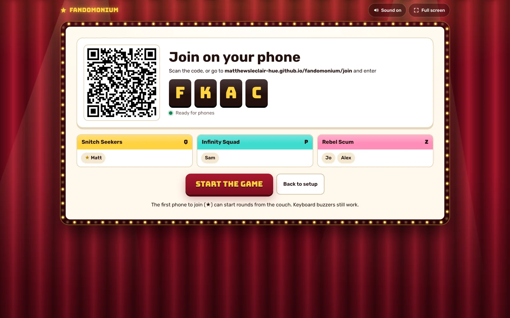
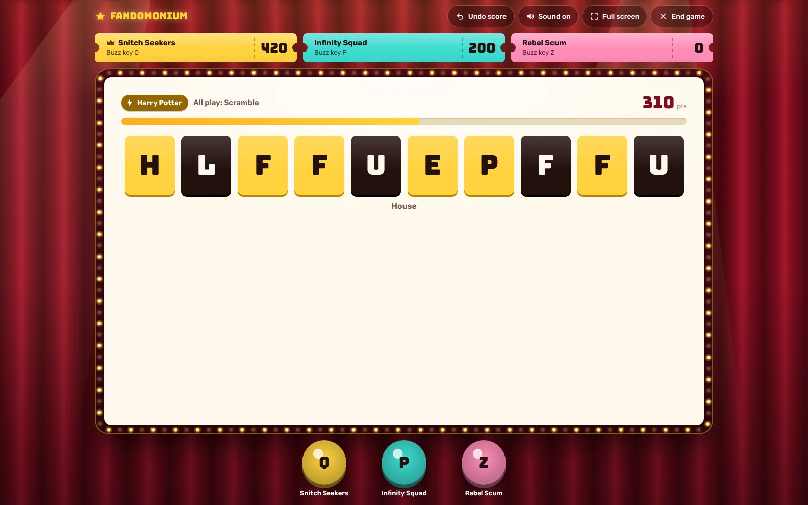

# Fandomonium

Movie, TV and anime trivia for 2 to 4 teams around one screen, with phones as controllers. 741 questions across 14 fandoms, each rated Easy, Medium or Hard:

- **Movies:** Harry Potter, Marvel, DC, Star Wars, Lord of the Rings, Disney & Pixar, Hunger Games, Jurassic Park
- **TV:** Friends, The Office
- **Anime and games:** Pokémon, One Piece, Naruto, Attack on Titan

**[Play in your browser](https://matthewsleclair-hue.github.io/fandomonium/play/)** · **[Download for Windows](https://github.com/matthewsleclair-hue/fandomonium/releases/latest/download/Fandomonium.exe)** · **[Website](https://matthewsleclair-hue.github.io/fandomonium/)**


## Play with phones

Turn on **Play with phones** on the setup screen. The TV shows a QR code and a four-letter room code, and everyone joins from their phone's browser (no app, Wi-Fi or mobile data both work).

- Pick your team in the lobby. Several people can share a team.
- On your team's turn, pick the fandom and answer on your phone.
- In All play, your phone becomes a big buzzer. Buzz first, then pick the answer, or type it for scrambles.
- The first phone to join is the VIP, who starts the game and moves things along from the couch.



Phones talk to the TV through EMQX's free public MQTT relay (`broker.emqx.io`) over secure WebSockets, so the TV and phones need internet. If the relay can't be reached, the lobby says so and the keyboard and on-screen buzzers still work. To use a different relay, change `NET.brokers` in `src/net.js`.

## Difficulty

Every question is tagged 1 (easy), 2 (medium) or 3 (hard). Pick **Easy**, **Medium** or **Hard**, or **Mixed**, which starts easy and gets harder each round. When a level runs out of fresh questions, the game borrows from the nearest level before repeating anything.

## How a game runs

Each round, every team gets its own question on the clock:

- **Trivia**: four answers, one right (200 points, 20 seconds)
- **Odd one out**: spot the one that doesn't belong (200 points)
- **Put it in order**: release dates, story order and more (300 points, 35 seconds)

Then comes **All play**. A puzzle reveals itself bit by bit while its value drops from 500 to 100, and the first team to buzz gets a shot:

- **Scramble**: letters slide into place one at a time
- **Who am I?**: four clues, hardest first
- **Emoji movie**: a film spelled out in emoji

A wrong pick locks that team out of the puzzle. The last round is worth double.

**Steals** (on by default): when a team misses its own question or runs out of time, the other teams get 8 seconds to buzz in. The first to buzz picks from the remaining answers and steals it for half the points.



## Controls

| Key | What it does |
| --- | --- |
| Q, P, Z, M | Buzz in for teams 1 to 4 |
| 1–4 or A–D | Pick an answer |
| Space or Enter | Next question, or skip the curtain |
| F11 | Full screen (Windows app) |

On a touchscreen, tap the buzzers and answers instead.

## Add your own questions

Every question lives in [`src/bank.js`](src/bank.js). The first number is the difficulty (1 to 3), then the question, then the right answer first; the game shuffles the choices.

```js
hp:{
  mc:[
    [1, "What’s the name of Harry’s owl?", "Hedwig", "Errol", "Pigwidgeon", "Hermes"],
  ],
  scr:[[2, "HOGWARTS", "Place"]],
  who:[[3, "Dobby", ["clue 1", "clue 2", "clue 3", "clue 4"], ["Kreacher", "Winky", "Griphook"]]],
}
```

Emoji puzzles take an optional fifth value, the hint shown under the emoji (it defaults to "Movie title").

To add a whole new fandom, add a key to `BANK` in `src/bank.js` and a matching entry in `src/cats.js` (name, colour, icon and setup group).

## Build it yourself

Needs [Node.js](https://nodejs.org) 20 or newer.

```
npm install
npm start        # play it in a window
npm run dist     # build release/Fandomonium.exe
npm run site     # build the website into site/
```

To test phones without the internet, run a local relay with `node test/broker.js 8888` and open `play/?broker=ws://127.0.0.1:8888`. `python3 test/e2e.py` plays a whole game from three simulated phones (it uses the `BROKER` environment variable when set).

| File | What it is |
| --- | --- |
| `src/game.html` | The whole game: layout, styles and logic |
| `src/bank.js` | Every question |
| `src/cats.js` | The fandom list: names, colours, icons, groups |
| `src/join.html` | The phone controller |
| `src/net.js` | The realtime relay connection shared by the TV and phones |
| `site-src/index.html` | The website's landing page |
| `main.js` | The Electron window for the Windows app |
| `build-web.js`, `build-site.js` | Inline the fonts and questions, assemble the site |

Pushing to `main` rebuilds and deploys the website and runs the phone test over the real relays. Publishing a release on GitHub (Releases, then Draft a new release, with a tag like `v1.1.0`) builds `Fandomonium.exe` on Windows and attaches it to that release.

## Notes

The Windows app isn't code-signed, so Windows may show "Windows protected your PC" the first time. Click **More info**, then **Run anyway**.

Fandomonium is fan-made trivia and isn't affiliated with or endorsed by any of the studios, publishers or companies behind these franchises. Titles and character names belong to their owners.
